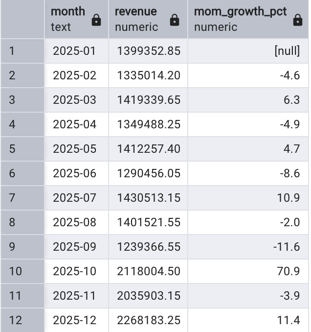
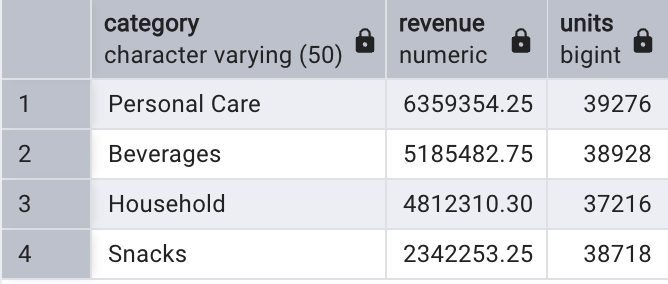

# FMCG Retail Sales Analysis (PostgreSQL)

This project uses SQL (PostgreSQL) to check and clean messy retail sales data, then answer business questions about revenue, monthly trends, brands, discounts and store performance.

> **Note:** The dataset is synthetic. It is generated by the script with random values, so it is for practice and demonstration, not real company data.

## Business problem

A packaged-goods company sells 12 products (beverages, snacks, personal care, household) through 10 stores across Chennai, Coimbatore, Bengaluru and Hyderabad during 2025. The raw sales data contains duplicate rows and missing values. The task is to check data quality, clean it, and report on performance.

## Data model

| Table | Description |
|---|---|
| `products` | 12 products with brand, category and unit price |
| `stores` | 11 stores with city and channel (Supermarket, Kirana, Online) |
| `sales` | About 5,000 raw daily sales rows (units sold, discount %) |
| `sales_clean` | Cleaned sales: duplicates and missing values removed |
| `sales_enriched` (view) | `sales_clean` joined to stores and products, with a calculated `revenue` column |

Revenue = units sold x unit price x (1 - discount %).

## What I did

1. **Built the database** with tables, primary keys and foreign keys.
2. **Audited data quality:** found missing unit values and duplicate (date, store, product) records.
3. **Cleaned the data** using `ROW_NUMBER()` to remove duplicates, and reconciled raw vs clean row counts.
4. **Created a reporting view** so every analysis query stays short and consistent.
5. **Answered business questions** with aggregation, joins and window functions.

## SQL concepts used

- `SELECT`, `WHERE`, `ORDER BY`, `DISTINCT`, `LIMIT`
- `GROUP BY` and `HAVING`
- `INNER JOIN` and `LEFT JOIN`
- Common table expressions (CTEs)
- Window functions: `ROW_NUMBER`, `RANK`, `LAG`, running totals with `SUM() OVER`
- Subqueries, views, indexes, `NULL` handling

## Business questions answered

- What is total revenue, and which category earns the most?
- Which are the top 5 products by revenue?
- How does revenue vary by city and sales channel?
- Which brands cross a revenue threshold?
- Which stores have no sales?
- Do higher discounts lead to more units sold?
- What is the month-over-month revenue growth and the running total?
- How are products ranked within each category?
- What share of revenue does each brand hold?
- What is the best-selling product in each city?
- Which stores perform below the average store?

## Key findings

*Fill these in from your own query results.*

- Top category by revenue: **[category]**, with revenue of **[amount]**
- Highest revenue month: **[month]**; revenue rose in the festive months (Oct to Dec) by **[x]%** over the previous month
- Discount effect: average units per sale rose from **[x]** at 0% discount to **[y]** at 15% discount
- Data quality: **[x]** duplicate rows and **[y]** missing values were found and removed

## Sample output

## How to run

1. Install PostgreSQL and pgAdmin.
2. Create a database named `fmcg_project`.
3. Open the Query Tool and run **Part 1** of `fmcg_sales_analysis_project.sql` once to create the tables and data.
4. Run **Part 4** to build `sales_clean` and the `sales_enriched` view.
5. Run the remaining queries one at a time.

Because the data is randomly generated, exact numbers will differ slightly each time Part 1 is run.

## Tools

PostgreSQL, pgAdmin 4

## Author

Deepaksenthilraj A T | [LinkedIn](https://www.linkedin.com/in/deepaksenthilraj)
